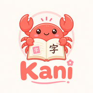

<!-- markdownlint-disable MD013 MD033 MD041 -->

  

<h1 align="center">Kani</h1>

  
  
  
  

Kani cures your kanji blindness. It analyses your AnkiDroid collection, finds the kanji you keep failing, works out *why* each one is hard for you, and drills exactly that weakness in as little time as possible.

## How it works

1. **Find the problem kanji.** Kani reads your AnkiDroid cards (read-only) and picks out kanji behind your leeches, lapses, and suspended cards.
2. **Diagnose why.** Each failure is traced to a cause: you don't know the meaning, you're mixing it up with a similar-looking kanji, an unusual reading, a same-sounding kanji, or you can't picture its shape.
3. **Repair, then revalidate.** Every kanji has just two long-term checks: *recognition* (kanji → meaning) and *contextual reading* (read the word, often inside your own mined sentence). When you fail one, Kani gives you a targeted repair exercise for that cause, then re-checks the core skill within a day.
4. **Hand it back to Anki.** Once Kani is confident you know a kanji, it can tag the related suspended notes `kani_repaired` (opt-in) so you can unsuspend them in AnkiDroid with one search: `tag:kani_repaired is:suspended`. Kani never changes your Anki scheduling.

## Features

* **RWKV-Curve memory model:** a small neural model of memory that reads your whole Kani review history and runs entirely on your phone.
* **A small, focused queue** instead of another full SRS backlog. Kanji you already read well in context are skipped or fast-tracked.
* **Targeted repair exercises:** similar-kanji and same-reading discrimination, reading choice, typed meaning, and handwriting with stroke-by-stroke checking.
* **Missing Kanji** finder, per-kanji mnemonic notes, home-screen widgets, and stats on what's being repaired and why.
* Automatic local backups with export/restore.

Think of it as a middle ground between full WaniKani/RTK and doing vocab with no kanji study at all.

If you study vocab without separate kanji study, but a handful of kanji keep tripping you up, this app is for you.

## License

Kani is licensed under the [European Union Public Licence v1.2](LICENSE) (EUPL-1.2).

The RWKV memory model in [`rwkv/`](rwkv/) is ported from Anki and remains under the [GNU AGPL v3 or later](rwkv/LICENSE). The EUPL lists the AGPL v3 as a compatible licence, so the app as a whole is distributed under AGPL-3.0-or-later. See [`THIRD_PARTY_NOTICES.md`](THIRD_PARTY_NOTICES.md) for third-party code, models, and data.
