<!-- markdownlint-disable MD013 MD033 MD041 -->

  

<h1 align="center">Kani</h1>

  
  
  
  

  <b>Stop mixing up the kanji you already study.</b>

  <picture><source media="(prefers-color-scheme: dark)" srcset="docs/screenshots/hero-dark.png">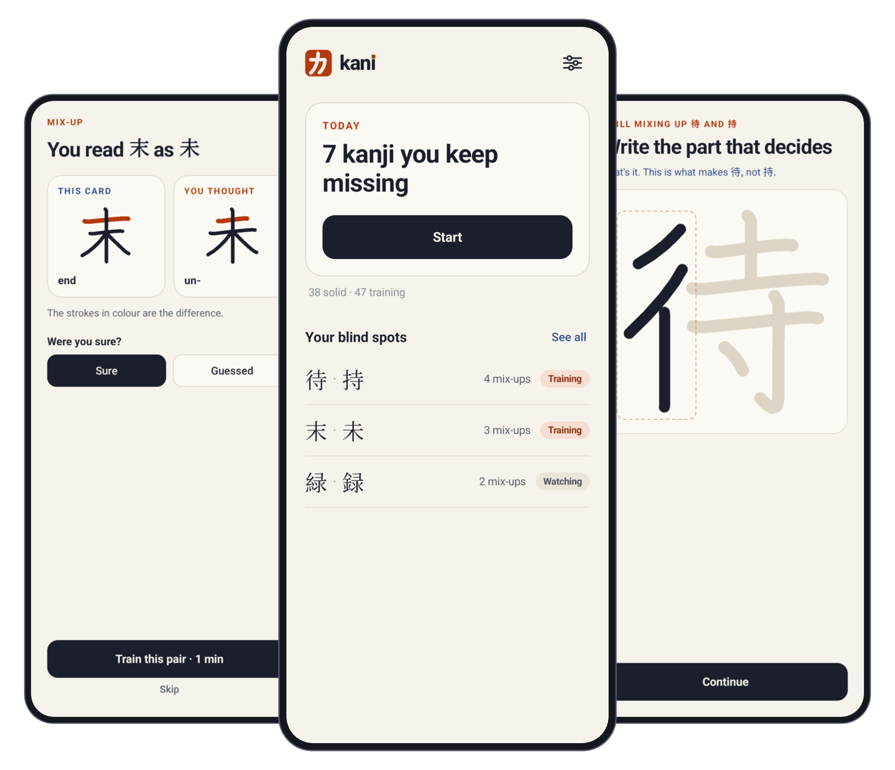</picture>

  <a href="https://github.com/bee-san/kanji_anki/releases"><b>Download the APK</b></a> · needs <a href="https://github.com/ankidroid/Anki-Android">AnkiDroid</a>

You know 待. You know 持. You still mix them up. Kani finds the kanji you keep getting wrong in Anki and trains just those, a few minutes a day.

## It finds them for you

  <picture><source media="(prefers-color-scheme: dark)" srcset="docs/screenshots/welcome-dark.png">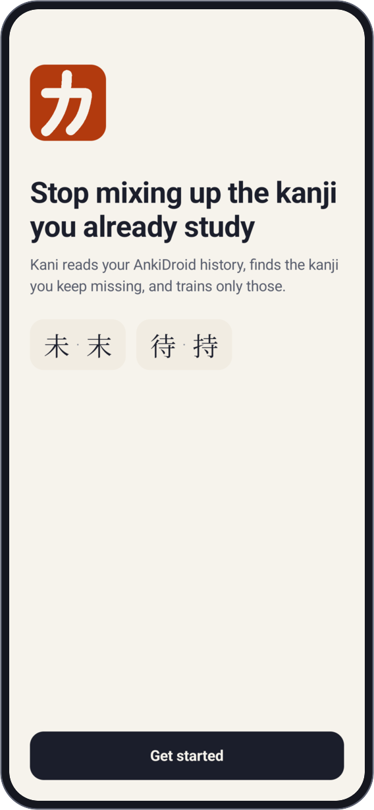</picture>
  <picture><source media="(prefers-color-scheme: dark)" srcset="docs/screenshots/scan-dark.png">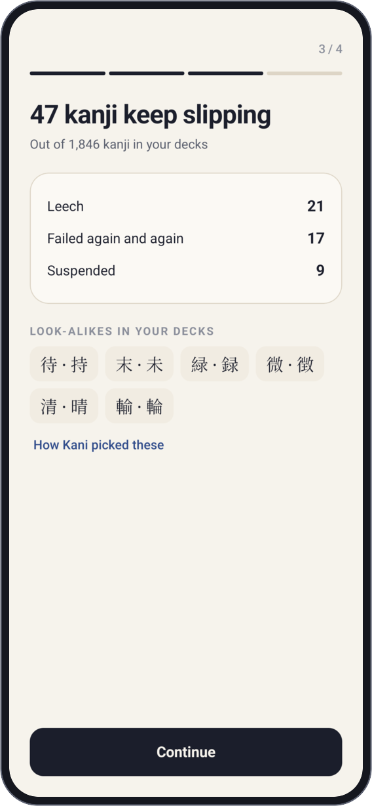</picture>
  <picture><source media="(prefers-color-scheme: dark)" srcset="docs/screenshots/words-dark.png">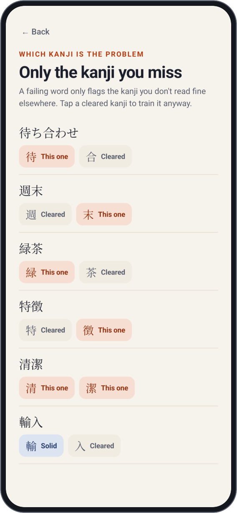</picture>

Kani reads your AnkiDroid history and picks out your leeches, repeat failures and suspended cards. A failing word only flags the kanji that's actually the problem: `待ち合わせ` flags 待, not 合.

## A few minutes a day

  <picture><source media="(prefers-color-scheme: dark)" srcset="docs/screenshots/check-dark.png">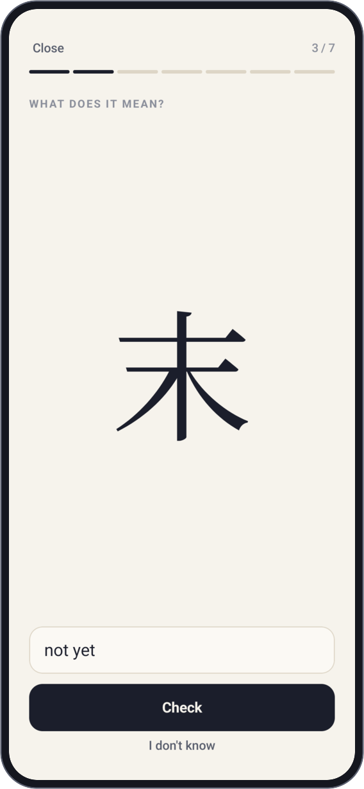</picture>
  <picture><source media="(prefers-color-scheme: dark)" srcset="docs/screenshots/check-reading-dark.png">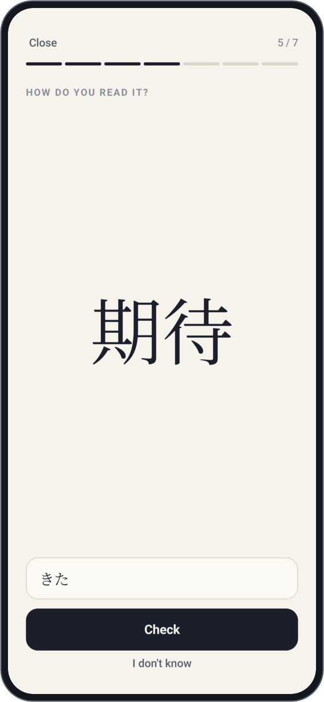</picture>
  <picture><source media="(prefers-color-scheme: dark)" srcset="docs/screenshots/reveal-dark.png">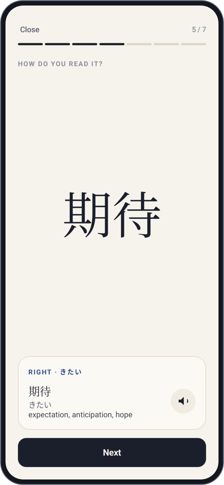</picture>

Type the meaning or the reading. Romaji turns into kana as you go.

## See why you got it wrong

  <picture><source media="(prefers-color-scheme: dark)" srcset="docs/screenshots/contrast-dark.png">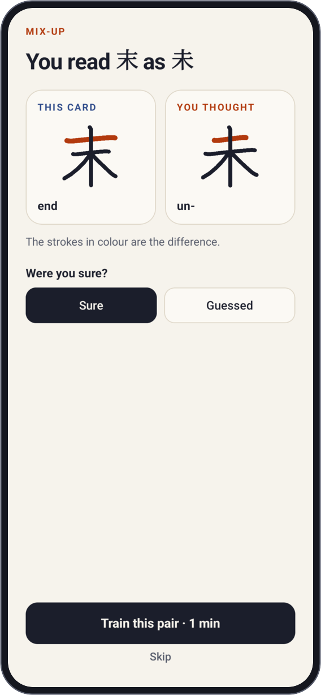</picture>
  <picture><source media="(prefers-color-scheme: dark)" srcset="docs/screenshots/hook-dark.png">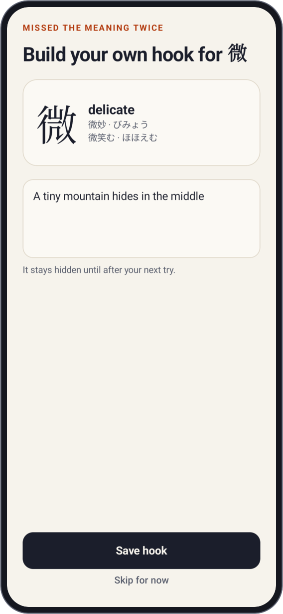</picture>
  <picture><source media="(prefers-color-scheme: dark)" srcset="docs/screenshots/early-dark.png">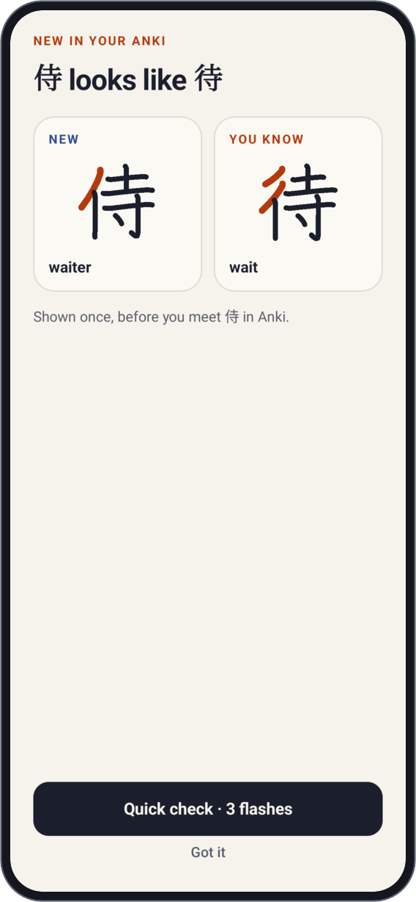</picture>

Mix up two look-alikes and Kani puts them side by side with the difference in colour. Keep missing a meaning and you write your own hook. New look-alikes get shown to you before they can trip you up.

## Sprint your look-alikes

  <picture><source media="(prefers-color-scheme: dark)" srcset="docs/screenshots/sprint-flash-dark.png">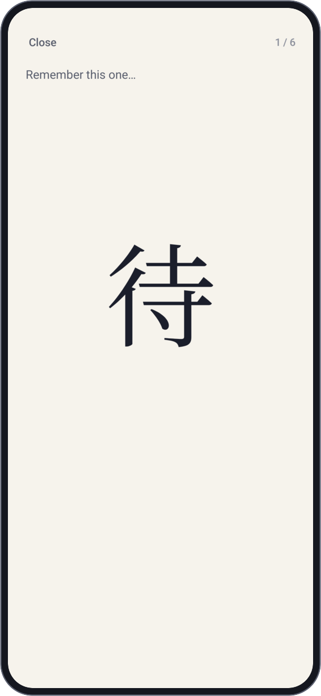</picture>
  <picture><source media="(prefers-color-scheme: dark)" srcset="docs/screenshots/sprint-pick-dark.png">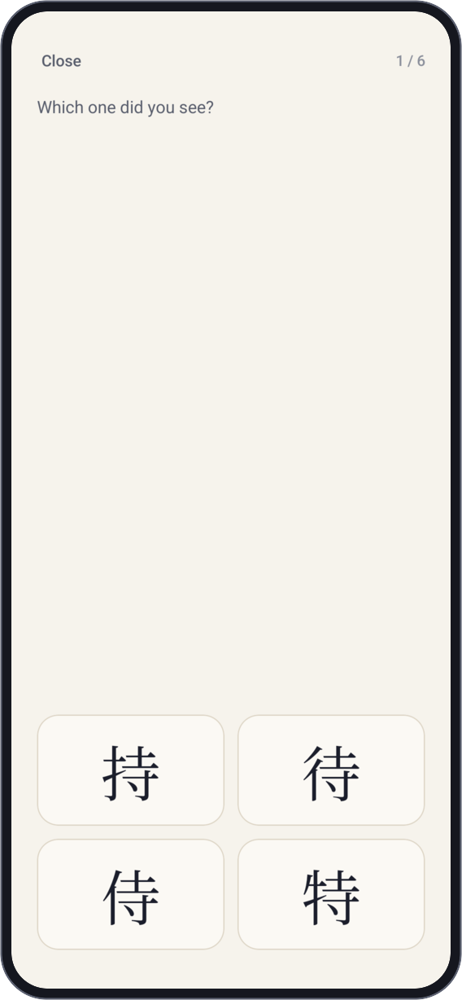</picture>
  <picture><source media="(prefers-color-scheme: dark)" srcset="docs/screenshots/sprint-feedback-dark.png">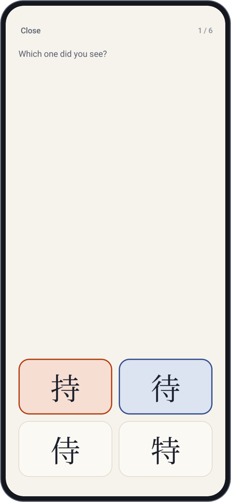</picture>

A kanji flashes, then you pick it out from its look-alikes. Works with a controller too.

## Write the part that decides

  <picture><source media="(prefers-color-scheme: dark)" srcset="docs/screenshots/write-empty-dark.png">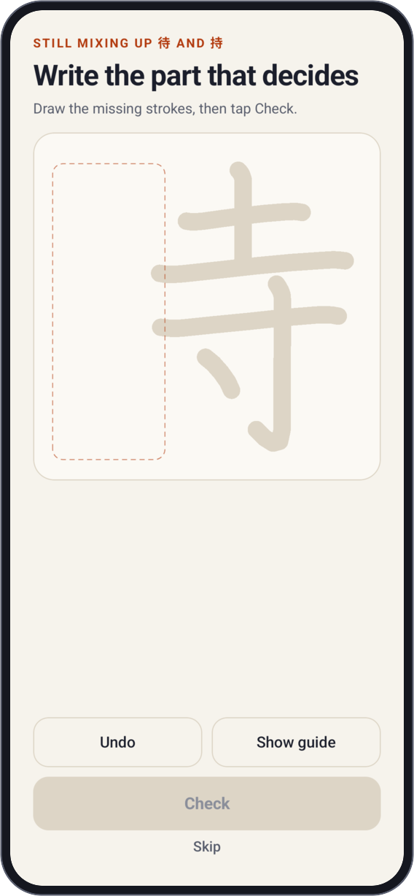</picture>
  <picture><source media="(prefers-color-scheme: dark)" srcset="docs/screenshots/write-dark.png">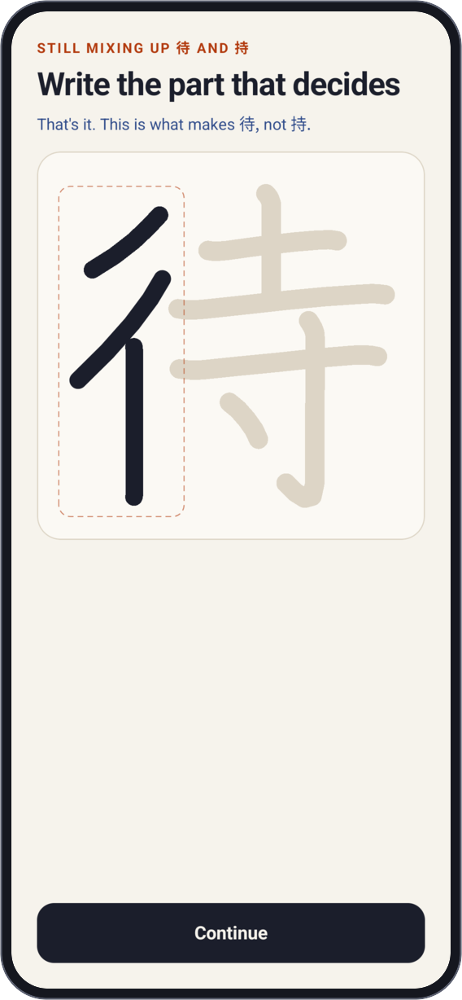</picture>

If a pair keeps coming back, you draw the strokes that set them apart.

## Solid after three days

  <picture><source media="(prefers-color-scheme: dark)" srcset="docs/screenshots/done-dark.png">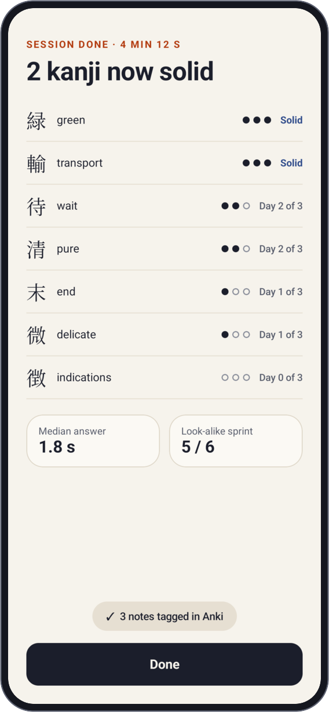</picture>
  <picture><source media="(prefers-color-scheme: dark)" srcset="docs/screenshots/blind-spots-dark.png">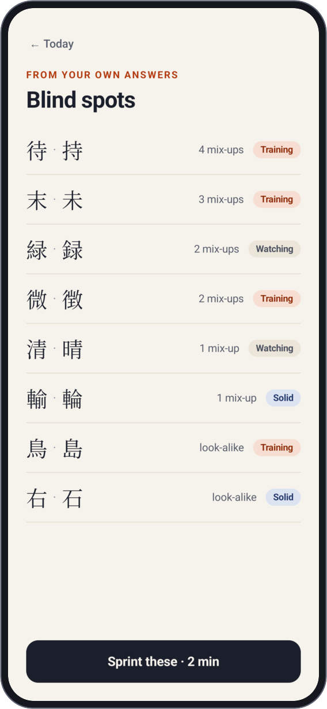</picture>
  <picture><source media="(prefers-color-scheme: dark)" srcset="docs/screenshots/today-dark.png">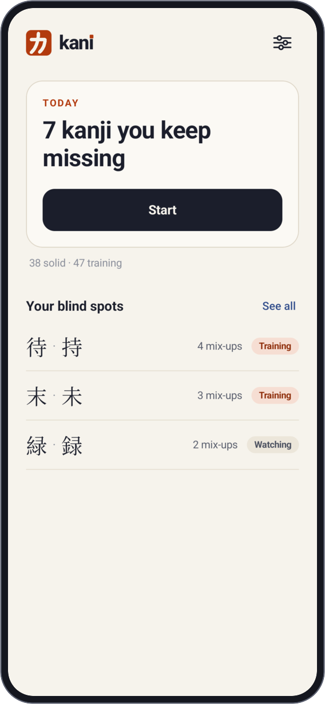</picture>

Get a kanji right, and fast, on three separate days and it's solid. Kani keeps an eye on it after that and brings it back if it starts to slip.

## Light or true black

  
  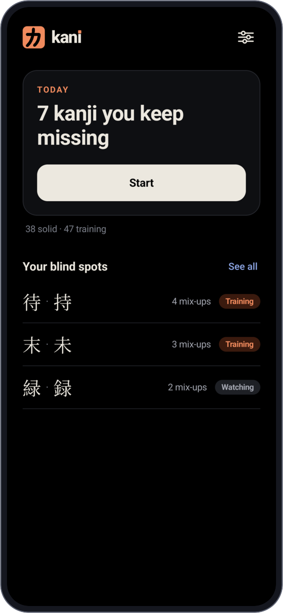
  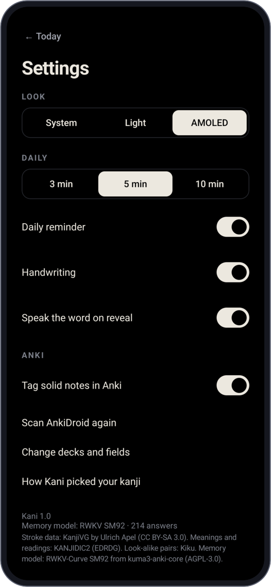

## It leaves your Anki alone

Kani never touches your scheduling and nothing leaves your phone. The only thing it can write is a `kani_solid` tag, and only if you turn that on.

## License

Kani is licensed under the [European Union Public Licence v1.2](LICENSE) (EUPL-1.2).

The RWKV memory model in [`rwkv/`](rwkv/) is ported from Anki and remains under the [GNU AGPL v3 or later](rwkv/LICENSE). The EUPL lists the AGPL v3 as a compatible licence, so the app as a whole is distributed under AGPL-3.0-or-later. See [`THIRD_PARTY_NOTICES.md`](THIRD_PARTY_NOTICES.md) for third-party code, models, and data.
